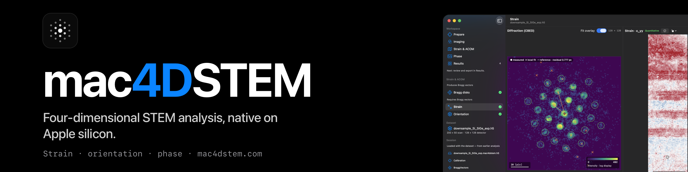
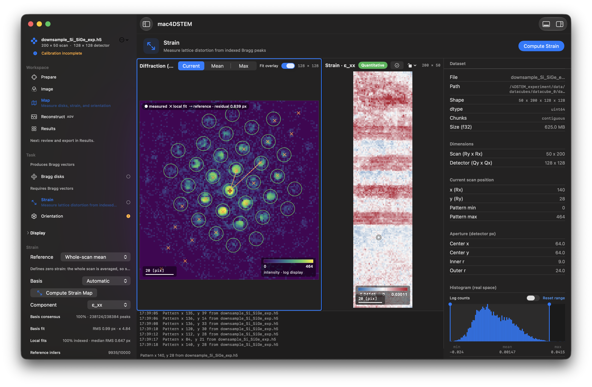

# mac4DSTEM

4D-STEM analysis on the Mac: virtual images, calibration, strain, orientation, phase and EDX spectrum images, worked
on interactively instead of in scripts.

mac4DSTEM is the companion to [macTEM](https://github.com/mac4DSTEM/macTEM). Both are free, open source and built for
Apple silicon.

  

## Download

Get the signed and notarised DMG:
[mac4DSTEM.dmg](https://github.com/mac4DSTEM/mac4DSTEM/releases/latest/download/mac4DSTEM.dmg) (all versions are on the
[releases page](https://github.com/mac4DSTEM/mac4DSTEM/releases)). It needs macOS 26 or later on an Apple silicon Mac.
Everything it needs is inside the app.

## What it does

Open a 4D-STEM dataset (py4DSTEM and other EMD/HDF5 files, Gatan DM3/DM4, and, less tested, Merlin MIB and EMPAD RAW)
and work through the workspaces in the sidebar. Detector, calibration and fit settings change against a live view, so
you see what a choice does while you make it.

- **Prepare**: inspect the dataset, crop, bin or filter hot pixels without touching the source file, and calibrate:
  probe and origin, elliptical distortion, the rotation between real and reciprocal space, and the reciprocal pixel
  size from a known crystal.
- **Imaging**: bright field, ADF and HAADF, and annular, rectangular or point detectors you place by hand.
- **Bragg Disks**: find the disks by cross-correlation with subpixel refinement, with diagnostics to judge the result.
  A learned disk detector runs on the Neural Engine.
- **Crystal Maps**: strain from a local lattice fit, orientation by template matching (ACOM) against your own CIF or a
  Materials Project structure, phase maps, and precipitate objects with their sizes, variants and number density.
- **Reconstruction**: DPC, iDPC, parallax and single-slice ptychography.
- **Spectroscopy**: EDX spectrum images, on their own or with the 4D scan. Auto ID suggests the elements, element maps
  and regions show where they are, and quantification gives wt% and at% with an uncertainty on every number.
- **Results**: review, save and export. Bragg vectors, datacubes and maps are written as EMD files that py4DSTEM reads.

Every quantity keeps its calibration and where it came from through display, export and reopening.

## Where the numbers come from

The 4D-STEM methods are ported from [py4DSTEM](https://github.com/py4dstem/py4DSTEM) and checked against it, pinned at
commit `f050d207` (version 0.14.19). Where the app departs from py4DSTEM the source says so in a `DEVIATION` note with
the reason. The rest is computed by the suite's Swift packages, each checked against the Python package it ports:
[CuboKit](https://github.com/mac4DSTEM/CuboKit) (the 4D-STEM core),
[DiffractoKit](https://github.com/mac4DSTEM/DiffractoKit) (crystallography and orientation),
[SpectroKit](https://github.com/mac4DSTEM/SpectroKit) (EDX),
[FormatoKit](https://github.com/mac4DSTEM/FormatoKit) (file readers),
[ImagoKit](https://github.com/mac4DSTEM/ImagoKit) (FFT and image maths) and
[MacEMUI](https://github.com/mac4DSTEM/MacEMUI) (the window and controls both apps share). A result that has not yet
been compared with a dataset of known truth says `validation: none` next to it.

Which function is checked against what, and to which tolerance, is in [`docs/parity.md`](docs/parity.md); speed
measurements are in [`docs/performance.md`](docs/performance.md).

## Building it yourself

You need Xcode 27 on an Apple silicon Mac. Open `mac4DSTEM.xcodeproj`, pick the `mac4DSTEM` scheme and press ⌘R. The
first build fetches the kits and MacEMUI from GitHub at the exact tags in `Package.swift`. The tests run with
`tools/run-tests.sh unit`. How the code is organised is in [`docs/architecture.md`](docs/architecture.md), and how a
release is built and notarised is in [`tools/release/README.md`](tools/release/README.md).

## Problems and ideas

Please open an issue. Reports with the file format, the dataset shape and what you expected help most, and a
difference from py4DSTEM with numbers attached is the most useful of all. [`CONTRIBUTING.md`](CONTRIBUTING.md) has
more, and [`SECURITY.md`](SECURITY.md) says how to report a security problem. What changed in each version is in
[`CHANGELOG.md`](CHANGELOG.md).

## Citing

If you use mac4DSTEM in published work, please cite it and py4DSTEM, where the methods come from. Both are in
[`CITATION.cff`](CITATION.cff).

## Licence

GPL-3.0-only ([`LICENSE`](LICENSE)). Third-party notices are in [`NOTICE`](NOTICE).

Contact: mail@mac4dstem.com
